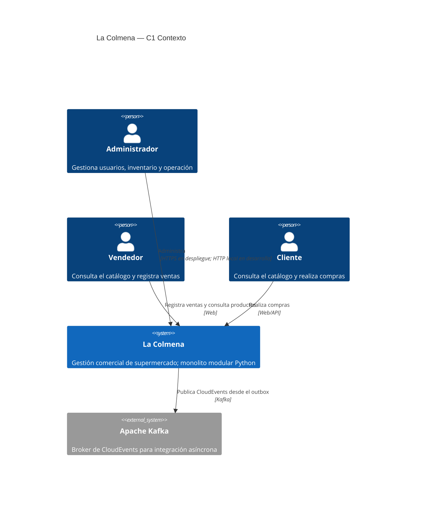
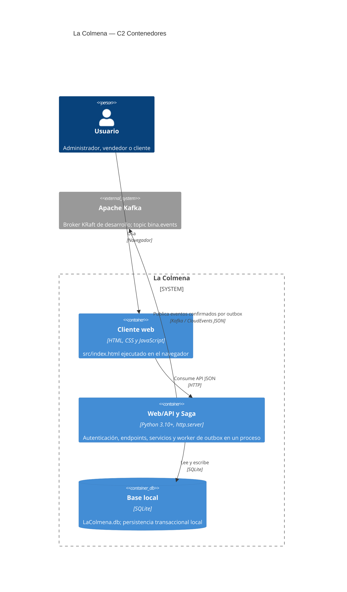
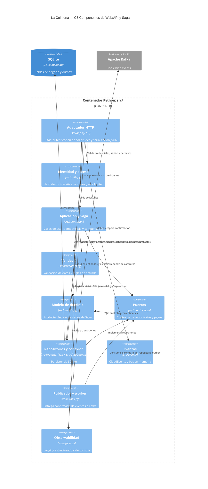

# D2 — Modelo C4, acoplamiento, Bounded Contexts e ISO/IEC 25010

## Alcance y estado

Este modelo describe la implementación actual de La Colmena: un monolito Python con interfaz web, API HTTP, SQLite y un worker de outbox que publica en Apache Kafka. Los diagramas C1–C3 son *as-is*; los límites de contexto y sus reglas describen el objetivo modular. Se distingue explícitamente lo implementado de las brechas: el código todavía contiene SQL de varios dominios en `src/app.py` y transacciones que cruzan el catálogo, los pedidos y el outbox.

El notebook [Modelo C4 de La Colmena](../notebooks/Modelo_C4_La_Colmena.ipynb) contiene los tres diagramas renderizados como SVG.

## 1. Modelo C4

### C1 — Contexto del sistema

La pasarela de pago actual es `PasarelaPagosMock`, ejecutada dentro del proceso Python; no se representa como sistema externo. En una integración real, debe reemplazarse por un proveedor externo con idempotencia durable.

### C2 — Contenedores

La base SQLite es un único archivo físico por simplicidad de despliegue local. Esa decisión no asigna propiedad compartida de tablas: cada contexto debe tener un único propietario lógico y acceder a otros contextos mediante contratos o eventos.

### C3 — Componentes del contenedor Web/API

El diagrama hace visible una brecha de diseño: `src/app.py` combina el adaptador HTTP con SQL de usuarios, productos, ventas y pedidos. Además, el flujo Saga abre una transacción SQLite que cruza datos de catálogo, órdenes y outbox. El C3 no presenta esa situación como aislamiento estricto.

## 2. Bounded Contexts y propiedad de datos

### Mapa de contextos propuesto

| Bounded Context | Responsabilidad | Tablas de propiedad exclusiva | Contrato de integración |
|---|---|---|---|
| Identidad y Acceso | Cuentas, roles, autenticación y auditoría de seguridad | `usuarios`, `auditoria_seguridad` | Servicio de autenticación; no exponer ni consultar la tabla de usuarios desde otros contextos |
| Catálogo e Inventario | Datos del producto, precio y disponibilidad | `catalogo_productos`; `productos` queda como tabla heredada hasta su migración | Consultas de catálogo y comandos de reserva/ajuste; eventos de stock |
| Comercio (Pedidos y Ventas) | Checkout, idempotencia, estado de pedido y venta | `ordenes_pedidos`, `ventas` | Contratos de checkout y eventos de pedido/venta |
| Abastecimiento | Pedidos a proveedores | `pedidos` | API propia y eventos de abastecimiento; no consultar tablas de inventario |
| Publicación de eventos | Serialización y transporte CloudEvents hacia Kafka | Sin tablas de negocio compartidas. El outbox debe pertenecer al contexto que origina cada cambio | `EventPublisher`/Kafka y eventos CloudEvents |

`outbox_events` es hoy una tabla centralizada. Para respetar la propiedad por contexto, el outbox transaccional debe residir en la misma frontera de datos del contexto productor (por ejemplo, `commerce_outbox` y `identity_outbox`) y el publicador debe consumir cada contrato sin escribir en las tablas de negocio de otros contextos.

### Reglas de límite

1. Cada tabla tiene un solo contexto propietario; ningún otro módulo consulta, inserta, actualiza o elimina directamente sus filas.
2. Ningún `JOIN` ni transacción de aplicación cruza tablas de contextos diferentes. El archivo SQLite puede seguir siendo el contenedor físico local, pero no elimina los límites lógicos.
3. Las consultas y comandos entre contextos usan puertos de aplicación; la propagación asíncrona usa CloudEvents con consumidores idempotentes.
4. El orquestador Saga coordina transacciones locales y compensaciones. No comparte una conexión SQLite para modificar tablas de otros contextos.
5. El outbox pertenece al contexto que modifica el agregado, de modo que cambio de negocio y evento se confirman en una sola transacción local.

### Brecha respecto a la implementación actual

- `src/app.py` crea y consulta directamente tablas de Identidad, Catálogo, Comercio y Abastecimiento. El acceso no está encapsulado por contextos.
- Hay dos representaciones de catálogo (`productos` y `catalogo_productos`); ambas guardan producto/stock y deben consolidarse bajo Catálogo e Inventario.
- `src.services` utiliza `database_connection` además de puertos de repositorio, y la Saga comparte una transacción entre catálogo, pedido y outbox.
- `outbox_events` recibe eventos de rutas y servicios de más de un dominio.

Por tanto, el repositorio tiene contextos lógicos identificables, pero **todavía no cumple el aislamiento técnico estricto**. El criterio de aceptación para cerrar la brecha es que las pruebas de integración verifiquen cero accesos cruzados a tablas y que cada contexto publique sus eventos dentro de su propia transacción local.

## 3. Métricas de acoplamiento de Martin

### Método

La unidad medida es cada módulo Python de producción; `src.events` agrupa `events/__init__.py`, `events/bus.py` y `events/cloudevent.py`. `main.py` se incluye como punto de entrada. Se excluyen pruebas, biblioteca estándar, dependencias externas y auto-dependencias. Cada importación directa entre dos componentes distintos cuenta como una arista única.

- **Ca (Afferent Coupling):** número de componentes internos que dependen del componente.
- **Ce (Efferent Coupling):** número de componentes internos de los que depende el componente.
- **I (Instability):** `Ce / (Ca + Ce)`.
- **A (Abstractness):** tipos abstractos / tipos declarados. En esta medición, las clases `ABC` y `Protocol` cuentan como abstractas.
- **D (Distance from Main Sequence):** `|A + I - 1|`. Solo se calcula si el componente declara clases; para módulos sin clases, `A` y `D` no aplican.

### Grafo de dependencias medido

| Componente | Depende de (Ce) |
|---|---|
| `main` | `src.app`, `src.logger` |
| `src.app` | `src.auth`, `src.database`, `src.events`, `src.logger`, `src.outbox`, `src.repositories`, `src.services`, `src.validators` |
| `src.auth` | — |
| `src.database` | — |
| `src.events` | `src.logger` |
| `src.interfaces` | `src.models` |
| `src.logger` | — |
| `src.models` | — |
| `src.outbox` | `src.interfaces`, `src.logger` |
| `src.repositories` | `src.database`, `src.events`, `src.interfaces`, `src.logger`, `src.models` |
| `src.services` | `src.database`, `src.events`, `src.interfaces`, `src.logger`, `src.models`, `src.validators` |
| `src.validators` | — |

El grafo contiene **25 dependencias internas**; la suma de Ca y la suma de Ce son ambas 25.

### Resultados

| Componente | Ca | Ce | I | A | D |
|---|---:|---:|---:|---:|---:|
| `main` | 0 | 2 | 1.000 | N/A | N/A |
| `src.app` | 1 | 8 | 0.889 | 0.000 | 0.111 |
| `src.auth` | 1 | 0 | 0.000 | 0.000 | 1.000 |
| `src.database` | 3 | 0 | 0.000 | N/A | N/A |
| `src.events` | 3 | 1 | 0.250 | 0.000 | 0.750 |
| `src.interfaces` | 3 | 1 | 0.250 | 1.000 | 0.250 |
| `src.logger` | 6 | 0 | 0.000 | 0.000 | 1.000 |
| `src.models` | 3 | 0 | 0.000 | 0.000 | 1.000 |
| `src.outbox` | 1 | 2 | 0.667 | 0.333 | 0.000 |
| `src.repositories` | 1 | 5 | 0.833 | 0.000 | 0.167 |
| `src.services` | 1 | 6 | 0.857 | 0.000 | 0.143 |
| `src.validators` | 2 | 0 | 0.000 | 0.000 | 1.000 |

Ejemplos de cálculo:

- `src.app`: `Ca=1`, `Ce=8`; `I=8/(1+8)=0.889`; `A=0`; `D=|0+0.889-1|=0.111`.
- `src.interfaces`: `Ca=3`, `Ce=1`; `I=1/(3+1)=0.250`; cuatro de cuatro clases son abstractas (`A=1`); `D=|1+0.250-1|=0.250`.
- `src.outbox`: `Ca=1`, `Ce=2`; `I=2/(1+2)=0.667`; `EventPublisher` es un `Protocol` entre tres clases (`A=1/3`); `D=|0.333+0.667-1|=0`.

La baja inestabilidad de `src.models`, `src.logger` y `src.auth`, junto con `A=0`, produce `D=1`: son componentes concretos y estables según Martin. `src.app`, `src.repositories` y `src.services` tienen Ce elevado; son los candidatos principales para reducir dependencias. `D` es una señal de balance entre estabilidad y abstracción, no una calificación aislada de calidad.

## 4. Atributos medibles ISO/IEC 25010:2011

Las metas siguientes son criterios verificables, no afirmaciones de certificación. “Pendiente” significa que falta una medición reproducible, aunque exista funcionalidad o pruebas unitarias.

| Característica | Métrica y criterio de aceptación | Estado/evidencia |
|---|---|---|
| Adecuación funcional | 100% de escenarios críticos de autenticación, permisos, catálogo, checkout, idempotencia, Saga y outbox pasan en la suite | Cubiertos por `tests/test_lacolmena.py`; repetir suite en cada entrega |
| Eficiencia de desempeño | P95 de `GET /api/productos` ≤ 300 ms y P95 de `POST /api/ordenes` ≤ 500 ms con dataset de 1.000 productos y carga de 10 clientes concurrentes | Pendiente: no hay prueba de carga ni baseline |
| Compatibilidad | 100% de la suite en Python 3.10 y 3.12; pruebas de integración con Kafka del Compose | Pendiente: el último entorno local probado es Python 3.12; broker real no verificado |
| Usabilidad | 100% de controles del login con nombre accesible; login y compra completables por teclado; cero errores críticos en auditoría WCAG automatizada | Pendiente: falta auditoría de accesibilidad automatizada |
| Fiabilidad | Ante fallo de Kafka, 100% de eventos siguen `PENDING`; ante fallo de pago, el stock reservado se restaura o la Saga permanece explícitamente `COMPENSATING` | Cubierto mediante pruebas de fallos de outbox y compensación en la suite |
| Seguridad | 100% de rutas protegidas responden 401 sin sesión; permisos insuficientes responden 403 sin mutación; rate limit responde 429 al superar el cupo | Cubierto por pruebas de autenticación, roles y limitación de intentos |
| Mantenibilidad | Registrar Ca, Ce, I y D por versión; criterio de arquitectura: cero SQL cruzado entre contextos y `Ce ≤ 5` para el adaptador HTTP tras separar rutas de sus casos de uso | Baseline actual en la sección 3; criterio de aislamiento todavía incumplido |
| Portabilidad | 100% de la suite en Windows y Linux; Compose Kafka inicia y pasa healthcheck en ambos entornos soportados | Pendiente: no hay matriz CI ni validación Docker multiplataforma |

### Protocolo mínimo de medición

1. Ejecutar `python -m unittest discover -s tests -p "test_*.py"` y conservar el reporte.
2. Ejecutar una prueba de carga con dataset y concurrencia fijados; reportar P50/P95/P99, errores y versión del entorno.
3. Ejecutar la matriz Python/OS y el healthcheck de Compose en CI.
4. Ejecutar una auditoría automatizada de accesibilidad sobre el login y el flujo de compra.
5. Recalcular el grafo de imports después de cada refactor y verificar que no haya accesos SQL fuera de los repositorios propietarios de cada contexto.
